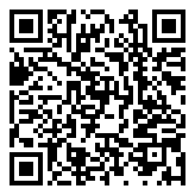

# ちゃぶ台返しリメンバー

スマホを振り上げて、ちゃぶ台を競技場の彼方へ飛ばす WEB アプリ。
名作アプリ「ちゃぶ台返し」のスマホブラウザ版リメイクです。

主人公はハゲ親父。砲丸投げの競技場で、ちゃぶ台をどこまで遠くへ飛ばせるかを競います。
ごくまれに、ちゃぶ台ではなく親父が飛んでいきます。

## 遊び方

**横画面で遊びます。** 縦向きのときは横にするよう案内が出ます（Android は全画面にして横向きに固定）。

1. スマホを横向きに持って、競技場（前）の方を向いて立つ
2. 「構える」を押す
3. 砲丸投げのようにクルッと1回転して正面に戻り、叫びながらスマホを振り上げる

センサーが使えない端末（PC など）では、画面をぐるぐる回して右上にフリックするタッチ操作になります。

**日本語と英語に対応しています。** 端末の言語が日本語なら日本語、それ以外は英語で表示し、タイトル画面で切り替えられます（英語のタイトルは「TABLE FLIP REMEMBER」）。
画面の文言は `js/i18n.js` にまとめています。Android のアプリ名も、日本語の端末では「ちゃぶ台返しリメンバー」、それ以外では「Table Flip Remember」です。

## 飛距離の決まり方

加速度センサーだけだと記録が数段階に固まってしまうので、複数のセンサーを混ぜて記録をばらけさせています。

| 要素 | センサー | 効果 |
| --- | --- | --- |
| 腕力 | 加速度のピーク | 初速 |
| 瞬発力 | 加速度の変化率（加加速度） | 初速 |
| 手首のキレ | ジャイロの角速度ピーク | 初速、ちゃぶ台の回転 |
| 回転 | ジャイロ（鉛直軸まわり）を積分した体の回転量 | 初速。回りすぎると親父が飛ぶ確率アップ |
| 気合 | マイク音量のピークと叫んだ長さ | 初速 |
| 振り上げ角度 | 加速度ベクトルの仰角（姿勢センサーで鉛直方向を判定） | 射出角 |
| 正面からのズレ | 構えた向きからの回転角 | 左右の方向。セクター（34.92°）の外に出るとファウル |
| 恵方 | コンパス | その年の恵方に向かって投げると縁起ボーナス |
| 風 | ランダム | 追い風／向かい風 |

計算式は `js/physics.js` にまとまっています。

## 動かし方（Web 版）

ビルド不要の静的サイトです。モーションセンサーとマイクは **HTTPS** でないと使えないので、
GitHub Pages などの HTTPS ホスティングに置いてスマホで開いてください。

ローカルで確認する場合:

```sh
python3 -m http.server 8000
# http://localhost:8000 を開く（PC ではタッチ／マウス操作モード）
```

iPhone ではモーションセンサーの許可ダイアログが出るので「許可」を選んでください。

Vercel に置く場合は `vercel.json` の設定で `npm run build` を実行し、`www/` を公開します（Android アプリに同梱するのと同じファイルです）。

見出しのフォント（Dela Gothic One）は、ゲームで使う文字だけに絞ったものを `fonts/` に同梱しています。
新しい文字を画面に足して、その文字だけ別のフォントになる場合は、元のフォントから作り直してください
（`pyftsubset` で、`index.html` と `js/*.js` に出てくる文字、かな、英数字を含めます）。

## Android 版（Google Play 配布用）

[Capacitor](https://capacitorjs.com/) でゲームのファイルをアプリ内に同梱しているため、ネットにつながっていなくても遊べます。

- 横画面固定・全画面表示（ステータスバー／ナビゲーションバーを隠す）
- プレイ中は画面が暗くならない
- Android の戻るボタン：計測中は取り消し、それ以外の画面ではアプリを終了
- 別のアプリに切り替えると音を止め、計測中なら取り消す
- 「シェア」は Android の共有メニューから LINE や X などを選べる
- マイクは叫び声の大きさを測るためだけに使います（録音・送信はしません）。初回に許可を求められます

アプリ ID は `jp.techgym.chabudai` です（Google Play に一度公開すると変更できません）。

### 広告（Google AdMob）

Android アプリでのみ広告を表示します（Web 版には広告は出ません）。

| 広告 | タイミング |
| --- | --- |
| インタースティシャル（全画面） | 結果画面で「もう一度」を押したとき、2 回に 1 回 |
| リワード | 結果画面の「広告を見て、次の1投を追い風にする」。最後まで見ると、次の1投が追い風 +3.0m/s になる |

- EU・英国など同意が必要な地域では、初回起動時に Google の同意確認画面が出ます。その地域では、タイトル画面の「広告の設定」から同意内容をいつでも変更できます。
- タイトル画面にプライバシーポリシー（https://techgym.jp/privacy-policy/ ）へのリンクを表示しています。
- 本番の ID の場所：広告ユニット ID（インタースティシャル・リワード）は `js/ads.js` の `production`、AdMob のアプリ ID は `android/app/src/main/res/values/strings.xml` の `admob_app_id` です。
  ID が未設定（`XXXXXXXXXX` やテスト用のアプリ ID）のままだと、Google Play 用のビルド（`ADMOB_MODE=production`）は `scripts/build-web.js` がエラーで止めます。
- 動作確認用 APK（Release の `chabudai.apk`）は常に **Google のテスト広告** を表示します。自分でタップしても問題ありません。
- 本番の広告を自分でタップするとアカウント停止の対象になるので注意してください。

### ビルド方法

**GitHub Actions（自動）**: Web 版や `android/` を変更して push すると、`.github/workflows/android.yml` が動作確認用の APK を作ります。
既定ブランチのビルドは GitHub の Release（`android-latest`）に自動で載るので、Android 端末で次の URL を開くか QR コードを読み取るだけで最新版をダウンロードできます。

https://github.com/techgymjp/chabudai/releases/latest/download/chabudai.apk



配布・掲示用にタイトル入りの QR コード（`docs/apk-qr-card.png`）もあります。

ダウンロードした `chabudai.apk` を開き、「提供元不明のアプリ」のインストールを許可するとインストールできます。
動作確認用の署名鍵（`android/app/debug.keystore`）はリポジトリで固定しているので、新しいビルドもアンインストールせずに上書きインストールできます。
（Release に載る APK はデバッグ版です。Google Play には下の手順で作る署名済み .aab を使います）

**手元の PC（Android Studio）**:

```bash
npm ci
npm run android:sync   # Web ファイルを www/ にまとめて Android プロジェクトへコピー
npm run android:open   # Android Studio で開く
```

アイコンと起動画面は `assets/` の元画像から `npx @capacitor/assets generate --android` で作っています。

### Google Play へ公開する手順

1. GitHub のリポジトリの Settings → Secrets and variables → Actions に、アップロード鍵の情報を 4 つ登録する（鍵は他のアプリと同じものを使えます）
   | 名前 | 内容 |
   | --- | --- |
   | `ANDROID_KEYSTORE_BASE64` | `base64 -i upload.jks \| tr -d '\n'` の出力 |
   | `ANDROID_KEYSTORE_PASSWORD` | キーストアのパスワード |
   | `ANDROID_KEY_ALIAS` | `upload` |
   | `ANDROID_KEY_PASSWORD` | 鍵のパスワード |
2. Actions の「Android build」が終わると、署名済みの `chabudai-release-aab`（.aab）ができる
3. [Google Play Console](https://play.google.com/console) でアプリを作成し、.aab をアップロードする
   （広告を含む・広告 ID を使用する、の申告が必要です。データセーフティでは、マイクの音声は端末内で音量を測るだけで収集・送信しないことも申告に合わせてください）

ストアに載せる画像（アイコン・日英のフィーチャーグラフィック・日英のスクリーンショット）と掲載文の下書きは `docs/store/` にあります（`docs/store/listing.md`）。

バージョン番号（versionCode）は Actions の実行回数が自動で使われます。表示用のバージョン名は `package.json` の `version` です。

## iOS 版（App Store 配布用）

Android 版と同じ Capacitor のプロジェクトに `ios/` を足しています（Bundle ID は `jp.techgym.chabudai`）。
Mac でのビルドと App Store への提出の手順は [docs/IOS_BUILD.md](docs/IOS_BUILD.md) にあります。

- 横画面固定・全画面表示、プレイ中は画面が暗くならない、iPhone 専用（iPad では iPhone 用の画面で動く）
- 起動時に App Tracking Transparency の確認、「はじめる」でマイクの確認（説明文は日英）
- iOS はマイクを開いている間は効果音が小さくなるので、投げた瞬間にマイクを閉じ、次の「構える」で開き直す
- 広告ユニットは Android と別（`js/ads.js` の `ios`）。AdMob のアプリ ID は `ios/App/App/Info.plist` の `GADApplicationIdentifier`
- App Store 用のビルドは `npm run ios:release`（本番広告）、実機での確認は `npm run ios:sync`（テスト広告）
- `.github/workflows/ios.yml` が push のたびに、署名なしでビルドできるかを GitHub の Mac で確かめる
- App Store 用の画像は `docs/store/ios/`、追加の掲載項目（サブタイトル・キーワードなど）は `docs/store/listing.md`

## ファイル構成

- `index.html` / `style.css` — 画面とUI
- `js/main.js` — 画面遷移とゲーム進行、Android アプリ向けの処理（戻るボタン・シェア・広告）
- `js/sensors.js` — 加速度・ジャイロ・姿勢・コンパスの取得と投てき判定、タッチ操作
- `js/audio.js` — マイク音量と効果音の合成
- `js/physics.js` — センサー値から初速・角度・ファウルなどを決める
- `js/world.js` — 投てきアニメーション、飛行の物理、カメラ
- `js/render.js` — 親父・ちゃぶ台・食器・競技場の描画
- `js/ads.js` — AdMob 広告（Android アプリのみ）
- `js/i18n.js` — 日本語・英語の文言と切り替え
- `scripts/build-web.js` — Android アプリに同梱するファイルを `www/` にまとめる
- `android/` — Android プロジェクト（Capacitor）
- `ios/` — iOS プロジェクト（Capacitor）

## ライセンス

著作権はテックジム株式会社に帰属します（All rights reserved）。許可なく複製・改変・再配布すること、
Web サイトやアプリ（Google Play、App Store など）として公開・販売すること、名前・ロゴ・アイコン・画像を使うことを禁止します。
テックジムの受講生が学習目的で複製・改変することは許可しますが、アプリストアでの公開・広告の掲載・販売などの商用利用は禁止です。
詳しくは [LICENSE](LICENSE) を見てください（同梱しているフォントは SIL Open Font License 1.1 です）。
